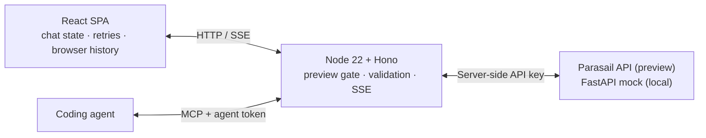

# Architecture notes

## At a glance

- Path shipped: Model Playground with two-column Compare and agent proposals.
- Production extension: resilience to mock and inference errors.
- Stack: React 19, Vite, Tailwind and Radix; Hono on Node 22; no server database;
  Fly.io hosting.
- Preview: real Parasail models behind a shared password. Local runs default to
  the vendored FastAPI mock, which returns canned answers.
- Production-readiness: 3/10. Streaming recovery, validation, credential handling
  and tests are implemented. Per-user identity, general rate limits, a daily
  budget, operational metrics and alerts remain future work.

## Architecture diagram



The production server serves the page and API in one process. During development,
Vite serves the page and proxies API calls to Hono. The inference service is
selected through server configuration.

## Auth

There are no user accounts. A shared password avoids account setup for the
preview. Browsers sign in and receive a 30-day HttpOnly, SameSite=Lax cookie,
marked Secure over HTTPS. Scripts can use Basic Auth. Changing the password
invalidates browser sessions and agent tokens.

A signed-in visitor can mint an agent token lasting one or seven days. The server
verifies its signature and grants access to `/api/mcp` only. Tokens cannot mint
more tokens or call the chat API; usage is counted in memory.

The Parasail key lives in the server environment: an ignored local `.env` or a
Fly secret. Startup requires both a key and preview password for the real API.
Docker excludes local environment files, and the build scans browser output for
Parasail key patterns.

Unauthenticated API requests return 401; page requests redirect to sign-in.
An upstream 401/403 becomes a non-retryable `service_misconfigured` error,
returned as 502, because the playground owns the rejected key. Health remains
open for platform checks.

The shared password provides no per-user attribution or individual revocation,
and login attempts are not throttled. Production would need user and organization
identity with per-user limits.

## Data model

Chats live in IndexedDB, capped at the newest 100 per browser profile:

```text
StoredChat { v: 1, id, title, createdAt, updatedAt, columns, proposal?, sharedFrom? }
Column     { id, settings, messages, proposed? }
```

Settings include model, system prompt, temperature, top-p, max tokens, stop and
seed. Assistant messages retain the settings used, status, attempts and available
usage and cost. Versioned records are validated on read; unsupported records are
skipped. A format change would need an explicit upgrader.

Share links encode a setup or chat in the URL fragment, which is not sent in the
HTTP request. Links have no server-managed expiry or revocation.

The application server persists no chat data. Its model cache, agent run counters
and execution queue are in memory. There is no tenant isolation within one browser
profile. With accounts and server persistence, I'd scope every chat and share to
an organization and authorize access through its user membership.

## State management

A React reducer keeps each chat's settings, messages and run transitions together;
the state belongs to one screen. Compare has two independent columns. A separate
display queue reveals words gradually while network consumption continues at
full speed. Timing statistics measure network arrival, independently of display
pacing.

IndexedDB stores history. Local storage caches model selection and holds pending
saves during page unload. A reloaded partial answer reopens as stopped. Reduced
motion displays incoming text immediately.

The server caches the model list for five minutes, coalesces concurrent refreshes
and falls back to stale data when refresh fails. Completions are not cached. At
10×, I'd keep model caches local but move limits and budget accounting into shared
storage before adding instances.

## Error & resilience

For interactive chat, the browser owns retries and the Hono handler makes one
completion call per attempt. Eligible failures before the first received token
allow up to three retries, with jittered backoff and a 10-second total automatic
wait budget. `Retry-After` is honored; a delay beyond that budget hands control
back to the user. A 429 shows a countdown with Cancel.

After text arrives, failure keeps the partial answer and requires an explicit
retry. Stop freezes the visible prefix, clears queued display text and aborts
the request. The server propagates cancellation upstream.

Chat streams have a 30-second first-token timeout, a 20-second stall timeout and
15-second heartbeats. The server validates settings and caps chat bodies at
512 KiB. It normalizes upstream responses into `token`, `error` and `done`
events, including errors after streaming has started.

MCP runs use a separate bounded retry loop on the server. They allow at most two
concurrent completions per process and 300 requested inputs per agent token.
The allowance resets on restart and is independent on each instance; it is not a
durable spend limit. Partial failures are returned without replaying the answer.

Fault injection reproduces overload, unavailability, rejected credentials and
dropped streams. Against the real API, the playground answers these faults
itself. Resuming interrupted streams remains future work.

## Observability

Chat attempt logs include run, request and upstream request IDs, model, outcome,
status, duration and fault information. MCP logs record tool, token ID, outcome,
run count, duration and available aggregate cost. These logs omit prompts and
answers.

The browser shows time to first token, throughput and estimated cost from reported
usage and available pricing. The model table supplies dated fallback prices.
There are no collected operational metrics, alert rules or distributed traces.
Request IDs are forwarded upstream.

I'd alert first on rejected credentials, sustained upstream overload, repeated
give-ups and interrupted streams.

## Tradeoffs I'd defend

1. Hono + Vite keeps streaming in one long-running server and leaves rendering in
   the browser. Server-rendered HTML would add little to this client-only flow.
2. Browser-owned chat retries make waiting and cancellation visible. MCP needs
   its own server loop because the agent does not use the browser run loop.
3. A normalized stream gives the client one error and usage contract across
   providers, at the cost of an adapter that needs careful tests.
4. Browser history and fragment-based shares avoid server persistence of chat
   content. The tradeoffs are browser-local history and links without revocation.

## What I'd build next

First, per-visitor concurrency limits and a daily budget that reserves maximum
request cost, then settles against reported usage. I'd make that accounting shared
before scaling the service.

Second, operational metrics and alerts built from complete attempt events,
including upstream timing, usage and cost. After that, user and organization
identity for attribution and access control, and resumable streams if disconnect
logs justify the extra state.
