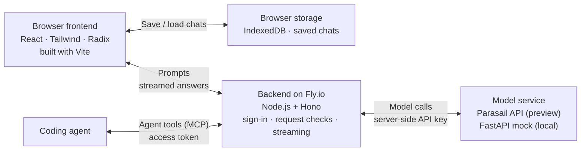

# Architecture notes

## At a glance

- **Path(s) shipped:** Path 1, Model Playground, plus side-by-side Compare and
  an MCP endpoint for coding agents. Production extension: error resilience.
- **Stack (frontend, backend, DB, hosting):** React + Vite, Hono, no server
  database (chats stay in browser IndexedDB), Fly.io.
- **What's available via preview URL vs local-only:**
  [Preview](https://speedboat-playground-yukunl.fly.dev/)
- **Estimated production-readiness, 1–10:** 5. Fine for a small trusted group;
  missing per-user accounts, server-side storage, spend limits and alerting.

## Architecture diagram



Vite runs the frontend development server locally and builds the frontend files
for deployment. On Fly.io, Hono serves those built files and handles API requests.

The browser sends prompts over HTTP. Hono sends the answer back in pieces using
Server-Sent Events (SSE).

## Auth

I use a shared password to keep strangers from spending the Parasail key.
Browsers use a sign-in page; scripts use Basic Auth.

- **Identity:** No individual user accounts.
- **Token storage / refresh:** The password and Parasail key are stored as Fly
  secrets. There is no automatic refresh.
- **What happens on 401:** Page requests redirect to sign-in, then back to the
  original page. API requests with missing or invalid credentials return 401.
- **What I'd do differently in production:** Per-user sign-in (SSO), organization
  membership and roles, per-user API keys, a way to revoke one user's access,
  and limits on sign-in attempts.

## Data model

I keep the newest 100 chats in IndexedDB for each browser profile. The main
saved fields:

```text
StoredChat { v: 1, id, title, createdAt, updatedAt, columns, proposal?, sharedFrom? }
Column     { id, settings, messages, proposed? }
```

- **Tenancy model (org → user → resource):** There are no user or team workspaces.
- **What lives in the browser vs the server:** Messages, model choices, system
  prompts and tuning parameters stay in the browser. The server doesn't save
  chat history or settings.
- **Migrations / schema-evolution story:** No migrations yet. Saved chats use
  format version 1.

## State management

- **Client-side state choice (and why not the alternative):** One React reducer
  holds the settings, messages and status of each run. A global store would be
  overkill for one screen.
- **Server-side caching or invalidation, if any:** Only the model list, cached
  for 5 minutes. If a refresh fails, the last good list is used. Answers are
  never cached.
- **What I'd change at 10×:** Chats can stay in the browser. I'd move limits and
  agent run counts to shared storage so all servers use the same counts, then
  load-test how many open streams one server can hold.

## Error & resilience

Try failures on the preview with
[Weather Control](https://speedboat-playground-yukunl.fly.dev/?debug).

- **Where the retry boundary lives:** Chat retries happen in the browser, only
  before any text is received: up to 3 retries (about 1 s, 2 s, 4 s), never
  sooner than `Retry-After` specifies. MCP retries happen on the server, because
  agents have no browser.
- **What happens when a stream drops mid-request:** The text so far stays on
  screen, marked interrupted, and the user can retry. The server ends a request
  if no text arrives within 30 s, or if an active stream goes silent for 20 s.
- **What happens when the mock returns 429 (you can simulate this):** The user
  sees a countdown they can cancel, then an automatic retry. After 3 failed
  retries, an error card offers Retry or another model. In Weather Control,
  "Busy skies, clears up" sends two 429s, then succeeds; these faults never
  reach Parasail.
- **What I'd add for production that I didn't add here:** Per-account rate and
  spend limits, and alerts. Later, resuming a cut-off answer if disconnects
  become common.

## Observability

- **Logs:** One JSON line per chat attempt and per agent tool call, collected by
  Fly: IDs, outcome, status and duration. Prompts and answers are never logged.
- **Metrics:** Only in the browser: time to first token, speed, tokens and
  estimated cost. No server-side operational metrics are collected.
- **Traces (if any):** None. Each request's ID is sent to Parasail as
  `X-Request-Id`, so logs can be matched by hand.
- **What I'd alert on first:** Repeated failed sign-ins from one IP (not logged
  yet), long stretches of overload, and more requests that fail after all
  retries or streams that cut off.

## Tradeoffs I'd defend

1. **Keeping the key on the server.** Calling Parasail directly from the browser
   would expose the shared API key. The Hono server holds it, checks the password
   and serves MCP. Chat state, history and retries stay in the browser.
2. **Chat retries in the browser.** Each wait is a countdown users can cancel.
   Retrying quietly on the server could leave them watching a long spinner.
   MCP retries run on the server because agents have no browser.
3. **One stream format.** I translate both mock and real API responses into
   `token`, `error` and `done` events so the UI handles them the same way. This
   adds a translation layer that needs its own tests.
4. **Pacing the text.** Parasail's fast, uneven bursts made answers jump. I added
   a word buffer that speeds up when a backlog builds. The display can lag
   behind the network; speed stats still use arrival times.

## What I'd build next

### Functionality

- **Tool calling:** Let the model being tested call tools and MCP servers, so
  people can evaluate its tool use alongside its answers.

### Production readiness

- **Identity and credentials:** Per-user sign-in, access control and an API key
  for each account.
- **Limits:** Enforce per-account request, concurrency and spend limits across
  servers, and throttle sign-in attempts.
- **Persistence:** Save chats on the server, with migrations, backups and
  tested restores.
- **Multi-tenancy:** Check account ownership on every read and write, with tests
  that one customer can't see another's data.
- **Operations:** Central logs, tracing, metrics and alerts.
