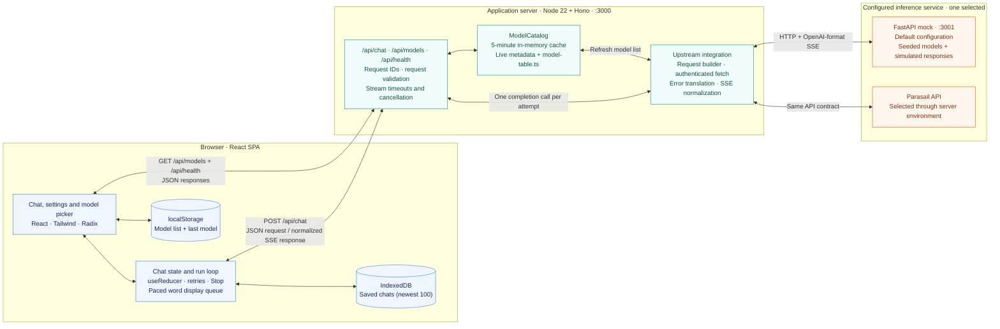

# Current project architecture

This diagram describes the implementation checked on October 25, 2026. The README identifies it as phases 1–5 and 8 (compare); phases 6 and 7 are deferred. `architecture-notes.md` and `design.md` also describe planned features.

The boxes inside the browser and application server are modules in those runtimes, not separate services. Bidirectional arrows represent requests and their responses. The upstream integration uses `/v1/models` and `/v1/chat/completions`; `PARASAIL_BASE_URL` selects the service, and `PARASAIL_API_KEY` stays on the server.

## How a chat runs

1. The UI hands settings and conversation messages to `useChat`. Its reducer keeps the open chat in memory: one column, or two in compare, each its own conversation with its own settings. In compare, one message starts a run in each column, and each column's settings are edited on their own. Chats left mid-answer stay in memory as background chats; their run events still reach them, and once they finish the UI saves them to history and lets them go.
2. `startRun` sends `POST /api/chat` with a run ID, request ID and attempt number. It owns automatic retries: at most three, only for eligible failures before any response text arrives, with at most 10 seconds of automatic backoff waiting. Offline waiting is separate.
3. Hono assigns or accepts a request ID, enforces a 512 KiB body limit, validates the shared Zod schema and checks the model against the catalog when available.
4. The server builds an OpenAI-compatible streaming request and calls the selected inference service once for that attempt. A cold or expired catalog can also require a model-list fetch.
5. The server normalizes upstream SSE into `token`, `error` and `done` events. `done` includes usage when reported and estimated cost when pricing and usage are available. Failures before the SSE response starts use the JSON error envelope.
6. The browser consumes SSE immediately and feeds a separate word display queue, which updates Markdown on animation frames. The queue speeds up for large backlogs and drains before a successful run is marked complete. Stats retain network arrival and completion times. Reduced-motion mode displays incoming text immediately. An interrupted answer shows all text received so far; Stop freezes the visible prefix, clears queued text and aborts the request. The backend propagates cancellation upstream and applies a 30-second first-token timeout, a 20-second stream-stall timeout and a 15-second heartbeat.

## State, shared code and diagnostics

| Component | Responsibility | Implementation |
|---|---|---|
| Browser UI | Chat, composer, settings and model selection | [App.tsx](../src/client/App.tsx), [settings](../src/client/settings/) |
| Conversation state | Current messages, settings, attempt timeline and run status in React memory | [use-chat.ts](../src/client/chat/use-chat.ts), [reducer.ts](../src/client/chat/reducer.ts) |
| Client run loop | Fetch, SSE consumption, retries, cancellation and paced word display | [run-stream.ts](../src/client/chat/run-stream.ts), [display-queue.ts](../src/client/chat/display-queue.ts), [retry.ts](../src/client/chat/retry.ts) |
| Browser storage | Saved model list and last model selection in `localStorage` | [use-models.ts](../src/client/use-models.ts) |
| History | Saved chats in IndexedDB, saved when a run starts or ends and when settings change, and when a chat left mid-answer finishes in the background. An answer still streaming when the page goes away keeps the text shown so far: IndexedDB writes are dropped during unload, so `pagehide` leaves it in `localStorage` and the next load saves it. Reopened after a reload through `sessionStorage`; a sidebar you show or hide; delete with undo, clear all | [history](../src/client/history/) |
| Share links | Setup or whole chat encoded after `#s=` (deflate + base64url), validated with Zod when opened; never sent to the server. A setup link can carry an agent's proposal, its claims for each column, shown in a banner and saved with the chat | [share](../src/client/share/), [agent-handoff.md](agent-handoff.md), [share-link script](../scripts/share-link.ts) |
| Code | The setup as a curl or Python call to Parasail's API, generated in the browser from the same request builder the server uses; the reader supplies their own key | [code](../src/client/code/) |
| API entry | Request ID middleware; preview gate; health, models, chat, agent-token and MCP routes | [app.ts](../src/server/app.ts), [request-id.ts](../src/server/middleware/request-id.ts), [preview-gate.ts](../src/server/middleware/preview-gate.ts) |
| Agent connection | `POST /api/mcp`: MCP over Streamable HTTP, one JSON answer per message, no sessions. Tools to list models, run a setup on a few inputs with measured speed and cost, and make a proposal link. At most 2 upstream calls at a time, retried on 429. Agents send an agent token from `POST /api/agent-token`: signed with a key derived from the password, expiring after 1 or 7 days, 300 runs, `/api/mcp` only | [mcp.ts](../src/server/routes/mcp.ts), [tools.ts](../src/server/mcp/tools.ts), [complete.ts](../src/server/mcp/complete.ts), [agent-token.ts](../src/server/agent-token.ts), [connect-an-agent.md](connect-an-agent.md) |
| Chat handler | Validation, model lookup, stream lifecycle, heartbeat and per-attempt JSON logs to stdout | [chat.ts](../src/server/routes/chat.ts) |
| Server model catalog | Five-minute cache, shared concurrent refresh, stale fallback and metadata/pricing enrichment | [model-catalog.ts](../src/server/upstream/model-catalog.ts), [join-models.ts](../src/server/upstream/join-models.ts), [model-table.ts](../src/server/model-table.ts) |
| Upstream integration | Server-side credentials, request mapping, normalized streams and structured errors | [client.ts](../src/server/upstream/client.ts), [build-chat-request.ts](../src/shared/build-chat-request.ts), [normalize-stream.ts](../src/server/upstream/normalize-stream.ts), [translate-error.ts](../src/server/upstream/translate-error.ts) |
| Shared library | Zod schemas, TypeScript contracts, error/event types, the upstream request builder and an SSE parser imported by both sides; no separate runtime service | [src/shared](../src/shared/) |
| Fault injection | Browser Weather control, `_simulate`, and server stream drop/stall switches | [weather.ts](../src/client/debug/weather.ts), [faults.ts](../src/server/upstream/faults.ts), [simulate.ts](../src/server/upstream/simulate.ts) |
| Mock service | FastAPI, seeded in-memory data, synthetic completions and injectable failures | [main.py](../mock/mock-server/main.py), [store.py](../mock/mock-server/store.py), [chat.py](../mock/mock-server/routes/chat.py) |

The playground has no server-side database. Chat history lives in each visitor's browser (IndexedDB), and share links carry their content in the URL fragment, which browsers never send to the server. The mock has its own seeded in-memory store and supports optional file persistence through `MOCK_PERSIST_PATH`; the supplied Compose configuration does not enable it.

Application rate limits, daily budget enforcement and the full observability system are described in the design but are not implemented in this snapshot. Body-size and settings limits, request IDs, basic attempt logs, per-answer cost calculation and the preview password gate are implemented. With `PLAYGROUND_PASSWORD` set, the page and every `/api` route except health need it, including direct calls to `/api/chat`. Browsers sign in on `/login` and get a 30-day cookie; scripts send the password as Basic Auth. Coding agents send an agent token instead, which opens `/api/mcp` and nothing else ([connect-an-agent.md](connect-an-agent.md)). The server refuses to start against the real API without it.

## Running the components

| Mode | Browser assets | API | Inference service |
|---|---|---|---|
| Local development (`npm run dev:all`) | Vite on `:5173` | Vite proxies `/api` to Hono on `:3000` | Local mock on `:3001` by default; environment can select Parasail |
| Production build (`npm start`) | Hono serves `dist/client`, with an SPA fallback | Same Hono process on `:3000` by default | Configured mock or Parasail API |
| Docker Compose | `app` container serves the built SPA on `:3000` | Same `app` container | Separate `mock` container on `:3001` by default; app waits for mock health |

The production build creates `dist/client` and `dist/server`; a build check scans the browser output for strings shaped like Parasail keys. See [vite.config.ts](../vite.config.ts), [index.ts](../src/server/index.ts), [Dockerfile](../Dockerfile), [docker-compose.yml](../docker-compose.yml) and [check-bundle-secrets.mjs](../scripts/check-bundle-secrets.mjs).
